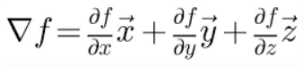
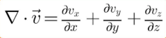
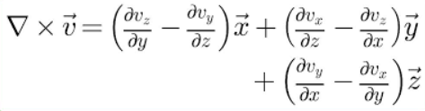
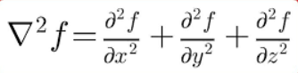
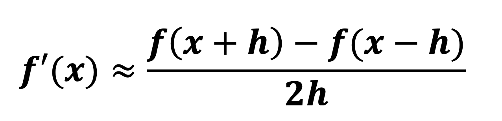

# Differential Operators (3D)

The goal of this folder is to implement the four vector differential operators which are recurring operators in physics equations.

### Gradient ∇ (Nabla / Del)

Vector of first-order partial derivatives in each axis. Gradient takes a scalar/concentration field and produces a vector field, mapping out how the scalars are spatially increasing across the field. It shows you the direction the values are increasing towards.

Note that the notation shows unit direction vectors, not sum of each derivative, output is a **vector**.

### Divergence

Sum of first-order partial derivatives of each directional component of a **vector**. Divergence takes a vector field and produces a scalar field, mapping out the rate the flow is changing across the field. Positive divergence signals an increasing flow which suggests that the volume is expanding and a negative divergence suggests volume is compressing.

Not to be confused with the **Venturi** effect where narrowing space increases _velocity_ of a fluid. Velocity increasing does not equal to positive divergence. Divergence factors in volume differential across space, if an inlet and outlet produces the same volume, divergence is zero.

Note that the output is a **scalar**, sum the derivatives of each directional component together.

### Curl

Vector of first-order partial derivatives

### Laplacian Δf or ∇²f

Sum of second-order partial derivatives

 

# Approximation of Differentiation

We notice differentiation in each of the operators so how can we "translate" them into operators that we can represent in code?

We need to convert continuous expressions into discrete arithmetic and we can do so using the **Finite-difference** method.

### Finite-difference

The idea is to sample a local derivative using neighboring elements. If you wanted the gradient of a scalar along the X axis, we can take the next element along the X axis and calculate difference against length / step.

### Forward, Backward and Central difference

Then comes the next question: which neighboring element should we sample against?

Forward difference takes x (current point) and x + h, where h is the step between each point (assuming a uniform grid). In element access, x + h is the same as [i + 1], where traversing by 1 element is the equivalent of moving spatially by the step h.

Backward differences takes x (current point) and x - h.

Central difference takes x + h (forward neighbor) and x - h (backward neighbor), and you divide the difference against 2h since the spatial length has doubled.

Order of accuracy dictates how quickly approximation error shrinks as you reduce h. Forward and Backward difference is First-Order accurate, while Central difference is Second-Order accurate.

Boundary concerns would be a factor as to which method we would choose. Elements along the edges of the field would not have both forward and backward neighbors but one of either.

### First-order Derivatives

Applying central difference, differentiating X would be **ddx = (f[i + 1, j, k] - f[i - 1, j, k]) / 2h**, where i is the element notation for the X axis.

